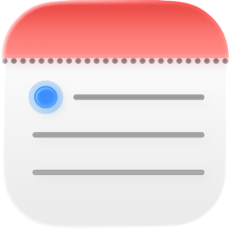
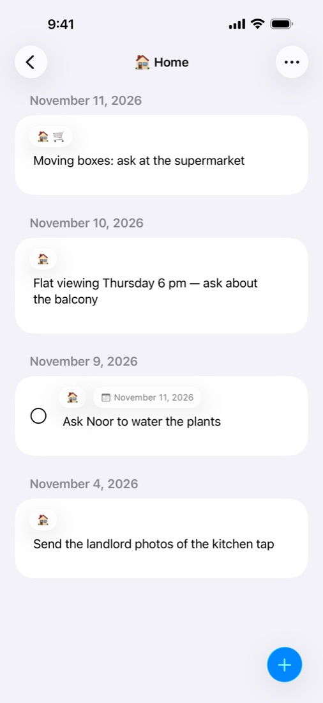

<p align="center">
  
</p>

<h1 align="center">QuickNote</h1>

<p align="center">
  Daily notes for iPhone. <b>Capture now, sort later.</b><br>
  <a href="https://ionas-dev.github.io/QuickNote/">Website</a> ·
  <a href="https://ionas-dev.github.io/QuickNote/privacy.html">Privacy</a> ·
  <a href="https://github.com/ionas-dev/QuickNote/issues">Issues</a>
</p>

<p align="center">
  
</p>

QuickNote opens straight to today's note, so a thought is saved before it's gone. When you have a moment, you give it structure: tag it, turn it into a to-do, or move it to the day it belongs to.

## Features

- **One note per day** made of text blocks. Open the app and start typing.
- **Tags** with an emoji or a colour, and a view per tag across all days.
- **To-dos linked to Apple Reminders.** Ticking one off in either app keeps both in sync.
- **Move blocks** to another date with a scrollable month picker.
- **Untagged view** that collects everything you haven't sorted yet.
- **Month calendar** with dots on days that have notes.
- **Customisation:** light/dark, sans/serif/rounded/monospaced fonts, card or plain list style.
- **Private by design:** notes stay on the device as JSON files. No account, no server, no tracking.
- English and German.

## Requirements

- Xcode 26.2 or later
- iOS 26.2 or later (iPhone)

## Building

```bash
git clone https://github.com/ionas-dev/QuickNote.git
cd QuickNote
open Notizblock.xcodeproj
```

Select the **Notizblock** scheme and an iPhone simulator, then run. Internally the project and target are still called *Notizblock*; *QuickNote* is the display name.

From the command line:

```bash
xcodebuild -project Notizblock.xcodeproj -scheme Notizblock \
  -destination 'platform=iOS Simulator,name=iPhone 17' build
```

To run on a device or archive for the App Store, set your own development team and bundle identifier in the target's *Signing & Capabilities*.

## Project structure

| Path | Contents |
|---|---|
| `Notizblock/App/` | App entry point and navigation |
| `Notizblock/Models/` | Blocks, tags, metadata |
| `Notizblock/Services/` | `NotesStore` (one JSON file per day plus a tag index), `TagStore`, `EventKitManager` (Reminders) |
| `Notizblock/Views/` | SwiftUI views: daily note, calendar, tags, untagged, settings, shared components |
| `Notizblock/Support/` | Formatting, Markdown styling, settings, helpers |
| `Packages/MarkdownKit/` | Local Swift package for inline Markdown scanning (with tests) |
| `AppStore/` | App Store texts and the screenshot pipeline (see its README) |
| `site/` | Website with support and privacy pages, deployed to GitHub Pages |

## Contributing

Bug reports and ideas are welcome as [issues](https://github.com/ionas-dev/QuickNote/issues). For larger changes, please open an issue first so we can talk about it.

## License

[MIT](LICENSE)
